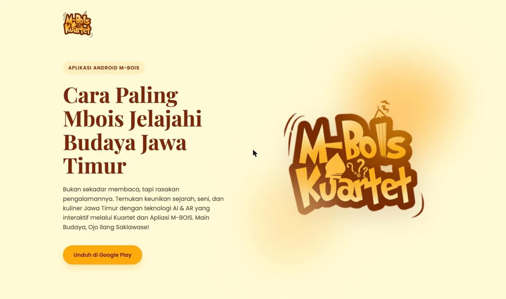

# M-BOIS website

Landing page and privacy policy for [M-BOIS](https://github.com/khrlanamm/M-BOIS), the Android companion app for an educational card game about East Javanese culture. The app placed in the Top 50 of the student category at BudayaGO! 2025.

Live at [m-bois.web.app](https://m-bois.web.app). The app is on [Google Play](https://play.google.com/store/apps/details?id=com.kuartet.mbois).



## Pages

| URL | File | Content |
|---|---|---|
| `/` | `public/index.html` | App introduction, the Google Play button, and a link to the privacy policy |
| `/privacy-policy` | `public/privacy-policy.html` | Privacy policy linked from the Google Play listing |

Plain HTML and CSS with no build step and no JavaScript bundle. Fonts are Playfair Display and Poppins from Google Fonts.

## Hosting

Firebase Hosting, site `m-bois`. `cleanUrls` serves `privacy-policy.html` at `/privacy-policy`, and every other path falls back to `index.html`.

```sh
npm install -g firebase-tools
firebase login
firebase deploy --only hosting
```

## License

All rights reserved. The source code is public for reference only. See [LICENSE](LICENSE).
